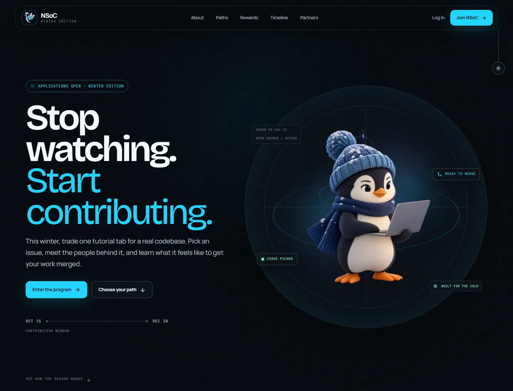

# NSoC Winter Edition

A responsive, motion-led landing page concept for the **Nexus Spring of Code Winter Edition**. It turns the official program information into a focused event experience built around one idea: stop watching tutorials and start contributing to real open-source projects.



## What makes it different

- An original winter developer mascot with two Motion-powered states: coding by default, then closing the laptop and waving on hover or tap
- A restrained falling-snow system that automatically disables when the user prefers reduced motion
- The official NSoC winter swan logo in the navigation, closing CTA, favicon, and Apple touch icon
- Three clearly explained participation paths: Contributor, Project Kernel, and Campus Ambassador
- Expandable reward tiers, an interactive timeline, sponsor network, and a validated sponsor contact flow
- A real light/dark theme rather than a decorative color inversion
- Mobile-first layouts tested at phone, tablet, and desktop breakpoints

## Tech stack

| Area | Tools |
| --- | --- |
| Framework | Next.js 16 App Router, React 19, TypeScript 5 |
| Runtime | Bun |
| Styling | Tailwind CSS 4, custom design tokens, tw-animate-css |
| UI primitives | Radix UI, shadcn-style component patterns, Lucide |
| Motion | Motion (Framer Motion), GSAP + ScrollTrigger, canvas-confetti |
| State and data | Zustand, Axios |
| Forms | React Hook Form, Zod |
| Theme | next-themes |
| Fonts | Bricolage Grotesque, Manrope, JetBrains Mono — all self-hosted |

## Interaction system

The page uses Motion for character and interface behavior, and keeps GSAP limited to scroll-triggered section reveals.

- Hover or tap the penguin to switch from the coding pose to the closed-laptop wave pose.
- The mascot, status chips, orbital rings, theme pull, and snow each move at different speeds to create depth.
- Opening the first-place reward triggers a small celebratory confetti burst.
- Role tabs use shared client state so the mission content changes without page navigation.
- Every nonessential animation respects `prefers-reduced-motion`.

## Run locally

Requirements: [Bun](https://bun.sh/) 1.4 or newer.

```bash
git clone https://github.com/Raghav7-tech/NSOC-Winter-.git
cd NSOC-Winter-
bun install
bun run dev
```

Open [http://localhost:3000](http://localhost:3000).

## Commands

```bash
bun run dev      # local development server
bun run lint     # ESLint 9 verification
bun run build    # production build and TypeScript validation
bun run start    # serve the production build
```

## Project structure

```text
src/
├── app/
│   ├── api/program/route.ts   # static program-data endpoint
│   ├── globals.css            # visual system and responsive behavior
│   ├── icon.png               # official NSoC favicon
│   ├── layout.tsx             # metadata, fonts, and theme provider
│   └── page.tsx               # server page boundary
├── components/
│   ├── landing.tsx            # interactive landing-page experience
│   ├── providers.tsx
│   └── ui/button.tsx
└── lib/
    ├── data.ts                # program content
    ├── store.ts               # Zustand experience state
    └── utils.ts               # class-name utility
```

## Quality checks

- `bun run lint` — passes
- `bun run build` — passes
- All application routes are statically prerendered
- Official hero imagery is optimized to WebP
- Core content renders without waiting for the internal Axios refresh
- Keyboard focus, skip navigation, semantic landmarks, dialog focus management, and reduced-motion fallbacks are included

## Assets and content

Program facts, links, sponsors, rewards, dates, and the official winter logo are based on the supplied NSoC task material and the current [NSoC website](https://www.nsoc.in/). The winter developer penguin was created specifically for this redesign and optimized for web delivery.

## Deployment

The project is ready for Vercel or Netlify. For Vercel, import this repository and keep the detected Next.js defaults; the build command is `bun run build`.

---

Built as a developer-selection submission for NSoC Winter Edition.
